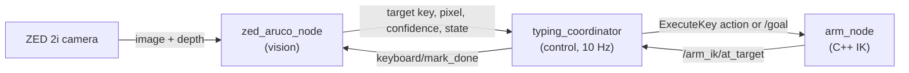

# Autonomous Keyboard Typing for a Rover Arm

ROS 2 Humble system that lets a rover's robotic arm type on a physical keyboard by itself. A ZED 2i camera finds the keyboard using ArUco markers, locates the target key, and a closed loop controller drives the arm to press it. Built with Quantum Robotics (Tecnológico de Monterrey) for the Equipment Servicing task of the University Rover Challenge (URC).

<!-- TODO: add a GIF or short video of the arm typing here -->

<!-- TODO: add measured results here (keys pressed correctly / total attempts, average time per key) -->

## How it works



### Vision pipeline (`zed_aruco_node`)

Four ArUco markers (`DICT_4X4_50`, subpixel corner refinement) frame the keyboard. Their inner corners give a homography that rectifies the keyboard into a canonical top view, where each key is located on a Spanish layout model (18 units wide, 6 rows).

Each frame runs a fallback chain, so the target survives partial occlusion by the arm itself:

| State | What happens | Confidence |
|---|---|---|
| `TRACKING` | Lucas Kanade optical flow follows the last known key position | 1.0 |
| `ARUCO` | All markers visible, homography recomputed from their corners | 0.9 |
| `FLOW` | Markers occluded, homography estimated from Lucas Kanade tracked features with RANSAC | 0.7 |
| `HOLD` | Last valid homography reused for up to 1.0 s | 0.5 |
| `SEARCHING` | No valid estimate, target published as invalid | 0.0 |

Two constant velocity Kalman filters smooth the target key position and the keyboard origin, reducing jitter before the target reaches the controller.

### Control (`typing_coordinator`)

Two operating modes:

* **Action mode:** one `ExecuteKey` goal per key, mapped from pixel coordinates to the arm frame (linear calibrated mapping for a vertical panel, or full TF projection).
* **Servo mode (visual servoing):** a PI controller turns the pixel error between the gripper and the key into small Y/Z corrections (4 px deadband, 12/20 px alignment hysteresis, 3 mm max step). Once aligned, the arm presses forward in 1.5 mm steps (15 mm max travel), retracts and returns to base.

Servo states: `IDLE → WAIT_TARGET / WAIT_CONFIDENCE / WAIT_STATE → WAIT_SERVO_INIT → ALIGNING → ALIGN_HOLD → ALIGNED_READY_PRESS → PRESSING → RETRACTING → RETURNING_BASE → COMPLETE → WAIT_NEXT_KEY`

### Inverse kinematics (`arm_ik`, C++)

Closed form IK for a 4 link arm (0.10, 0.43, 0.43 and 0.213 m). Accepts goals through an action server (`/arm_ik/execute_key`), a pose topic (`/goal`) and named poses (`/predefined`), and reports arrival on `/arm_ik/at_target`.

### Safety

The arm never moves by accident:

* `motion_enabled=false` and `publish_on_action=false` by default (IK is solved but no joint commands are sent).
* Emergency stop topic (`keyboard/emergency_stop`) holds the arm immediately and cancels active goals.
* Motion halts after 3 failed press attempts on the same key, or if the arm does not confirm arrival in time.
* Target changes in the middle of a motion are ignored until the current key finishes.

## Packages

| Package | Language | Role |
|---|---|---|
| `zed_aruco` | Python | Vision node, typing coordinator, calibration probe, simulation fakes |
| `arm_ik` | C++ | Inverse kinematics and arm command interface |
| `typing_interfaces` | ROS IDL | `ExecuteKey.action` |
| `aruco_py` | Python | Legacy standalone detector, superseded by `zed_aruco` (see its README) |

## Running it

Build:

```bash
cd ~/ros2_ws
colcon build --symlink-install --packages-select typing_interfaces arm_ik zed_aruco
source install/setup.bash
```

Simulation without hardware (fake vision and fake arm):

```bash
ros2 launch zed_aruco no_hardware_integration.launch.py \
  servo_mode_enabled:=false motion_enabled:=true use_tf_targeting:=false text:=hola
```

Real hardware:

```bash
# Terminal A
ros2 run arm_ik arm_node --ros-args -p publish_on_action:=true

# Terminal B
ros2 launch zed_aruco zed_typing_integration.launch.py \
  motion_enabled:=false use_tf_targeting:=false require_transform_valid:=false

# After the arm is positioned and calibrated
ros2 param set /typing_coordinator motion_enabled true

# Type a word (works headless, no monitor needed)
ros2 topic pub --once /keyboard/type_word std_msgs/msg/String "{data: 'hola'}"
```

More detail:

* [docs/SETUP.md](docs/SETUP.md): one time setup and dependencies (the rover simulation uses [mi_rover_description](https://github.com/RMezSa/mi_rover_description), listed in `repos.yaml`).
* [docs/RUNTIME_COMMANDS.md](docs/RUNTIME_COMMANDS.md): full competition bring up and calibration.
* [src/zed_aruco/README.md](src/zed_aruco/README.md): launch options and every tunable parameter.

## Hardware

* Compute: NVIDIA Jetson Orin Nano
* Camera: Stereolabs ZED 2i
* Arm: Quantum Robotics rover arm (hardware drivers live outside this repo)

## Known limitations

* No physical contact sensor yet: reaching the maximum press travel is used as the success signal. The coordinator already listens on `keyboard/contact_pressed` for when one is wired.
* In competition mode the pixel to arm mapping is a linear model calibrated on site. TF based projection is implemented but needs a reliable camera to arm transform.
